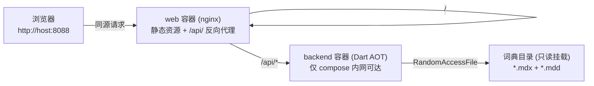

# Web 端部署指南

Web 端由两个容器组成，但对外**只暴露一个入口**：

- **web 容器（nginx）** — 托管 Flutter 静态前端，并把 `/api/` 反向代理到后端；这是唯一的入口。
- **backend 容器（Dart AOT）** — 解析 `.mdx` / `.mdd`，仅 compose 内网可达，不发布端口。

浏览器沙箱无法读取本机文件，因此词典的解析、检索与发音资源读取全部在后端完成，
前端通过同源 HTTP API 调用——没有 CORS，后端也不暴露文件路径给外部网络。

---

## 0. 本次实测记录（WSL2 Ubuntu + Docker 28.0.4）

在 WSL2 中执行 `docker compose -f docker/docker-compose.yml up -d --build` 后的实测结果：

| 项目 | 结果 |
|---|---|
| 镜像构建 | `local-dict-backend` / `local-dict-web` 均成功 |
| 容器状态 | backend `healthy`，web `Up (healthy)` |
| 对外端口 | **仅** `0.0.0.0:8088->80/tcp`；backend 显示 `8080/tcp`（未发布），宿主机访问 `:8080` 被拒绝 |
| 同源 API | `http://localhost:8088/api/health` → `{"status":"ok","dictionaries":1,"enabled":1,"totalEntries":434589,...}` |
| `GET /api/dictionaries` | 返回 1 本词典，含 `.mdx` / `.mdd` / `.css` 路径与 434,589 词条数 |
| `GET /api/search?q=tele&limit=5` | `exact` → `prefix` 分级返回，服务端耗时 **6 ms** |
| `GET /api/lookup?word=hello` | 完整词条：`American / Etymology / Explanation / Examples` 四个标签页、音标、例句 |
| `GET /api/audio?key=hello.mp3` | 经 nginx 代理 `200`，浏览器播放实测取回 17,756 字节（**38 ms**） |
| Range 请求（经代理） | `206 Partial Content` + `content-range: bytes 0-1023/17756`，响应体恰为 1024 字节 |
| 前端静态资源 | `main.dart.js` 3,580,791 B、`canvaskit.wasm` 7,229,946 B、音标 mp3 字节数与源文件一致 |
| MIME / 压缩 | `application/wasm`、`application/javascript`、`audio/mpeg`、`application/json` 均正确；`content-encoding: gzip` 生效 |
| 浏览器端到端 | 9 次 API 调用**全部同源**（`localhost:8088`），发往 `:8080` 的请求数为 **0**；检索 → 查词 → 发音全链路通过，**控制台 0 错误、0 失败请求** |
| 词典页状态 | 「已连接后端词典服务 / 词典由后端提供（1 本，共 434589 条词条）」+「含配套音频库 (.mdd)」「含专用样式表 (.css)」|
| 多词典热加载 | 向第二个挂载目录放入 979 B 测试词典后 `POST /api/reload` → `dictionaries:2, totalEntries:434594`（434589 + 5），**未重启容器**；删除该文件后 reload 回落为 1 本 |
| 跨词典归属 | 停用大词典后 `GET /api/lookup?word=damson` 由 `Mini Test Dictionary` 返回（音标 `[dam-zuhn]`、标签 `American/Examples`），`dictionaryName` 正确标明来源 |
| 启用状态保持 | 停用大词典 → reload 后 `enabled` 由 2 变为 **1**，即热加载不会重置启用/停用选择 |

---

## 1. 架构总览

前端与后端**整合为单一入口**：只暴露一个端口，nginx 既托管静态前端、又把 `/api/` 反向代理到后端容器。
浏览器看到的永远是同一个 Origin，因此不需要 CORS，后端也不会直接暴露在网络上。



| 能力 | 执行位置 | 说明 |
|---|---|---|
| 词典检索 / 词条查询 | **后端** | `.mdx` 随机访问解析，434,589 条词条索引常驻内存 |
| 词典原声发音 | **后端** | 从 `.mdd` 按需抽取 MP3 字节流，支持 HTTP Range |
| 音标（IPA）学习 | 前端（离线） | 打包在 `assets/audio/ipa/` |
| 26 字母发音 | 前端（离线） | 打包在 `assets/audio/letters/` |
| 词频排行榜 | 前端（离线） | 打包在 `assets/data/frequency_5000.json` |
| 生词本 / 查词历史 | 前端（离线） | 浏览器 localStorage |

后端与桌面端/安卓端**复用同一套解析器**（`lib/core/mdx/*`），不存在第二份实现。

### 为什么用 nginx 做静态层，而不是让 Dart 后端一并托管？

后端本身是纯 Dart，技术上完全可以自己吐静态文件。之所以仍由 nginx 负责静态资源，是因为静态交付有三个
容易被忽略的正确性细节，交给成熟的 Web 服务器更稳妥：

1. **MIME 类型** — `canvaskit.wasm` 必须是 `application/wasm`、`main.dart.js` 必须是
   `application/javascript`，否则 Flutter 引擎直接加载失败；nginx 的 `mime.types` 已覆盖。
2. **字节范围（Range）** — 静态音源与媒体需要 `206 Partial Content`。
3. **压缩** — 未压缩的 `main.dart.js + canvaskit.wasm` 约 10.8 MB，gzip 后传输量显著下降。

`/api/audio` 的 Range 由后端自己实现（已在 curl 中验证返回
`206` + `content-range: bytes 0-1023/17756`），nginx 仅做透传，不参与缓冲。

---

## 2. 前置条件

- Docker 24+ 与 Docker Compose v2
- 约 6 GB 可用磁盘（Flutter 构建镜像较大）
- 词典文件（`.mdx` 必需，同名 `.mdd` 可选，用于发音）

> **Windows 用户**：以下命令在 **WSL2 (Ubuntu)** 中执行。若 Docker Desktop 已开启 WSL 集成，
> WSL 内可直接使用 `docker` 命令。

---

## 3. 快速开始（Docker Compose）

```bash
cd /mnt/d/proj/flutter/dict        # 仓库根目录

docker compose -f docker/docker-compose.yml up -d --build
```

首次构建需要拉取 Flutter 镜像并编译 Web 产物，耗时较长；之后为增量构建。

启动后**只需访问一个地址**：

| 入口 | 地址 | 说明 |
|---|---|---|
| Web 应用（前端 + API） | http://localhost:8088 | nginx 托管静态资源并代理 `/api/` |
| 后端 API（直连） | — | 默认**不对外暴露**，仅 compose 内网可达 |

验证（全部走同一个 Origin）：

```bash
# 健康检查（经 nginx 代理到后端）
curl -s http://localhost:8088/api/health
# {"status":"ok","dictionaries":1,"enabled":1,"totalEntries":434589,"uptimeSeconds":3}

# 查词
curl -s "http://localhost:8088/api/lookup?word=hello" | head -c 200

# 发音：Range 透传
curl -s -D- -o /dev/null -H "Range: bytes=0-1023" \
  "http://localhost:8088/api/audio?key=hello.mp3" | grep -i content-range
# content-range: bytes 0-1023/17756
```

浏览器打开 http://localhost:8088 ，左侧「词典」页应显示**已连接后端词典服务**。

> 需要直接用 curl 调试后端时，取消 `docker-compose.yml` 中 `backend.ports` 的注释，
> 或执行 `docker compose exec backend curl -s localhost:8080/api/health`。

停止 / 清理：

```bash
docker compose -f docker/docker-compose.yml down          # 停止
docker compose -f docker/docker-compose.yml down --rmi local   # 同时删除镜像
```

### 3.1 词典配置（部署后如何加词典）

**为什么镜像里没有词典**：词典约 1.7 GB，且受各自授权约束，不适合随镜像分发。
因此词典在**运行时**通过只读挂载提供，镜像本身可自由分发；
更新词典只影响挂载目录，**不需要重新构建镜像**。

**挂载点与配对规则**

- 容器内路径由 `DICT_DIR` 指定，默认 `/dictionaries`，会**递归**扫描其中所有 `*.mdx`
- 同目录、同文件名的 `.mdd` 自动配对，用于发音原声（如 `X.mdx` ↔ `X.mdd`）
- 同目录下任意 `.css` 会被登记为该词典的词条样式表
- 可给多个目录，`DICT_DIR` 用 `;` 分隔

**方式 A — Compose（推荐）**

```bash
# 默认挂载仓库内的 Dictionary.com 20260913_hahaya/
docker compose -f docker/docker-compose.yml up -d --build

# 指向任意目录
DICT_PATH=/mnt/d/dicts docker compose -f docker/docker-compose.yml up -d --build
```

`DICT_PATH` 的相对路径以 `docker/` 目录为基准，默认值 `../Dictionary.com 20260913_hahaya`
即仓库根目录下的词典文件夹。

**方式 B — docker run**

```bash
docker run -d --name local-dict-backend \
  -v "/mnt/d/dicts:/dictionaries:ro" \
  local-dict-backend
```

**方式 C — 加载多本词典**

最省事的做法：把多本 `.mdx`（连同各自的 `.mdd`）放进**同一个目录**，递归扫描会全部加载。
若词典分散在不同目录，挂多个卷并扩展 `DICT_DIR`：

```yaml
services:
  backend:
    environment:
      DICT_DIR: "/dictionaries;/extra-dicts"
    volumes:
      - "/mnt/d/main-dicts:/dictionaries:ro"
      - "/mnt/d/extra-dicts:/extra-dicts:ro"
```

多本词典同时启用时，检索结果按精确 → 前缀 → 包含排序并跨词典去重；
查词按启用顺序取第一本命中者，响应中的 `dictionaryName` 标明来源词典。

**方式 D — 服务器上没有现成目录（云主机场景）**

用命名卷预置数据，避免依赖宿主机路径：

```bash
docker volume create dictdata
docker run --rm -v dictdata:/dictionaries -v /srv/dicts:/src:ro \
  alpine sh -c 'cp -a /src/. /dictionaries/'
# 再让 backend 使用该卷：docker-compose 中把绑定挂载换成
#   - "dictdata:/dictionaries:ro"
```

**新增词典如何生效（免重启热加载）**

- 容器**启动时**扫描一次挂载目录；
- 之后放入挂载目录的词典，调用 `POST /api/reload` 即可热加载，**无需重启容器**。
  实测（把第二本词典放进挂载目录后）：

  ```console
  $ curl -s -X POST http://localhost:8088/api/reload
  {"status":"ok","dictionaries":2,"enabled":2,"totalEntries":434594,
   "ids":["dictionary-com-20260913","mini"]}
  ```

  `434589 + 5 = 434594`，第二本已被识别；删除该文件后再 reload 会回落为 1 本。
- reload 会重新打开归档并重建内存索引（约 66 ms / 43 万词条）。切换瞬间少数在途请求可能失败，重试即可。
- 通过 `/api/dictionaries/<id>/enabled` 关闭的词典，其启用状态在 reload 后**保持不变**（实测 `enabled` 由 2 变为 1 即为此项）。

**配置后如何验证**

```bash
curl -s http://localhost:8088/api/health         # dictionaries / enabled / totalEntries
curl -s http://localhost:8088/api/dictionaries   # 每本的名称、词条数、文件路径
```

浏览器打开「词典」页也会显示已加载数量与每本的词条数、是否含发音库与样式表。

**注意事项**

- 挂载建议加 `:ro`；后端只读取词典，从不写入
- 未找到任何 `.mdx` 时后端**仍会启动**，但日志会给出
  `warning: no .mdx archive found in ...`，此时前端仅剩音标/字母/词频可用
- 词典文件的绝对路径会出现在 `/api/dictionaries` 响应中（容器内路径），
  这也是默认不把 backend 端口对外发布的原因之一

---

## 4. 单独构建 / 运行

### 4.1 仅后端

```bash
docker build -f docker/Dockerfile.backend -t local-dict-backend .
docker run --rm -p 8080:8080 \
  -v "/mnt/d/proj/flutter/dict/Dictionary.com 20260913_hahaya:/dictionaries:ro" \
  local-dict-backend
```

### 4.2 仅前端（静态托管，后端在别处）

镜像默认按**同源**构建（`DICT_API_BASE` 为空 → 客户端回退到网页 Origin）。
若把前端单独托管、后端在其它主机，则在构建期写死后端地址：

```bash
docker build -f docker/Dockerfile.web \
  --build-arg DICT_API_BASE=http://192.168.1.10:8080 \
  -t local-dict-web .
docker run --rm -p 8088:80 local-dict-web
```

此时不经过 nginx 代理，改为浏览器直连后端，需要后端 `ports` 对外发布，并依赖其 CORS 头。
也可以完全不重新构建，改用运行时覆盖：

```
http://your-frontend:8088/?api=http://192.168.1.10:8080
```

该地址会写入浏览器 localStorage，后续访问自动生效。

---

## 5. 配置项

### 5.1 后端

| 变量 | 默认值 | 说明 |
|---|---|---|
| `DICT_DIR` | `/dictionaries` | 词典目录，**递归**扫描其中的 `.mdx`；多个目录用 `;` 分隔 |
| `DICT_HOST` | `0.0.0.0`（镜像内） | 监听地址 |
| `DICT_PORT` | `8080` | 监听端口 |

也支持命令行参数：`--dir <目录> --host <地址> --port <端口>`。

词典与音频文件的配对规则：同目录下**同名**的 `.mdx` 与 `.mdd` 自动关联
（例如 `Dictionary.com 20260913.mdx` + `Dictionary.com 20260913.mdd`）。
同目录下任意 `.css` 会被记录为词条样式表。

### 5.2 前端

后端地址按以下**优先级**解析：

1. URL 查询参数 `?api=http://host:port`（会写入浏览器 localStorage，后续自动生效）
   ```
   http://localhost:8088/?api=http://192.168.1.10:8080
   ```
2. 浏览器已保存的设置
3. **编译期** `--dart-define=DICT_API_BASE=...`（Docker 通过 `--build-arg DICT_API_BASE=` 传入）
4. 网页自身 Origin（同源部署时自动生效）
5. `http://127.0.0.1:8080`

因此：**跨源部署**（前端与后端不同端口）用第 3 步写死地址；
**同源部署**（nginx 反向代理 `/api/`）把 `DICT_API_BASE` 置空即可零配置运行。

---

## 6. API 契约

所有响应为 `application/json; charset=utf-8`（音频除外）。

> **访问入口**：整合部署下统一走 web 容器（`http://localhost:8088/api/...`），
> 由 nginx 代理到后端。下例用 `$BASE` 表示；后端容器内部监听
> `http://backend:8080`，默认不对宿主机发布。

```bash
BASE=http://localhost:8088        # 整合部署入口（同源）
# BASE=http://localhost:8080      # 仅在后端单独发布端口时使用
```

| 方法 | 路径 | 说明 |
|---|---|---|
| `GET` | `/api/health` | 健康检查：词典数量、总词条数、运行秒数 |
| `GET` | `/api/dictionaries` | 已加载词典列表（含启用状态、词条数、文件路径） |
| `POST` | `/api/dictionaries/<id>/enabled` | 启用/停用某本词典，body：`{"enabled": true}` |
| `POST` | `/api/reload` | 重新扫描挂载目录，热加载新增/移除的词典（免重启），保留启用状态 |
| `GET` | `/api/search?q=&limit=` | 检索，返回 `exact` → `prefix` → `substring` 分级的词列表 |
| `GET` | `/api/lookup?word=` | 查词，返回完整解析词条（标签页、正文面板、音标、例句） |
| `GET` | `/api/audio?key=` | 发音 MP3 字节流，支持 `Range`（206 Partial Content） |

示例：

```bash
# 健康检查
curl -s "$BASE/api/health"
# {"status":"ok","dictionaries":1,"enabled":1,"totalEntries":434589,"uptimeSeconds":5}

# 前缀检索
curl -s "$BASE/api/search?q=tele&limit=5"
# {"query":"tele","results":[
#   {"word":"tele","matchType":"exact","dictionaryId":"dictionary-com-20260913","dictionaryName":"Dictionary.com 20260913"},
#   {"word":"tele-","matchType":"prefix", ... }, ... ]}

# 查词
curl -s "$BASE/api/lookup?word=hello" | jq '.entry | {word, phonetic, soundKey, tabs: [.tabs[].label]}'
# { "word":"hello", "phonetic":"[he-loh...]", "soundKey":"hello.mp3",
#   "tabs":["American","Etymology","Explanation","Examples"] }

# 发音（含 Range 请求）
curl -s -D- -o /dev/null -H 'Range: bytes=0-1023' \
  "$BASE/api/audio?key=hello.mp3" | grep -i content-range
# content-range: bytes 0-1023/17756
```

> `/api/search` 只返回词形与词典归属；中文简释、CEFR 等级、考纲标签由**前端**用本地词频库
> 富化，因此后端不重复实现该逻辑。

> 后端 CORS 头为 `Access-Control-Allow-Origin: *`。同源整合部署下浏览器不会发起跨源请求，
> 因此该头不被使用；仅在 §7.1 的前后端分离部署中生效，公网场景请按需收紧。

---

## 7. HTTPS / 反向代理

同源整合**已经是默认形态**（§1、§3），`/api/` 由 web 容器内的 nginx 代理，无需额外配置。
要在其外层加 HTTPS，只需在最前面再放一层 TLS 终止（下面以 Caddy 为例，自动申请证书）：

```
# Caddyfile
dict.example.com {
    reverse_proxy local-dict-web:80
}
```

或改用 nginx + certbot：

```nginx
server {
    listen 443 ssl http2;
    server_name dict.example.com;

    ssl_certificate     /etc/letsencrypt/live/dict.example.com/fullchain.pem;
    ssl_certificate_key /etc/letsencrypt/live/dict.example.com/privkey.pem;

    location / {
        proxy_pass http://local-dict-web:80;
        proxy_http_version 1.1;
        proxy_set_header Host $host;
        proxy_set_header X-Forwarded-For $proxy_add_x_forwarded_for;
        proxy_set_header X-Forwarded-Proto $scheme;
        proxy_read_timeout 60s;
    }
}
```

外层代理**不必**单独处理 `/api/`——它已经在 web 容器内被代理到后端；
也**必须**保留 `Range` 透传（Caddy 默认支持，nginx 需确认未剥离请求头）。

> 注意：web 容器内的 nginx 用变量 + `resolver 127.0.0.11` 延迟解析后端主机名，
> 这样即使后端缺席（仅跑前端）容器也能正常启动，只会让 `/api/` 返回 502。
> `127.0.0.11` 是 Docker 内嵌 DNS，在 Docker 之外运行该镜像时需改为可用的 DNS 地址。

### 7.1 备选：前后端分离部署

若希望前端走 CDN、后端独立扩容，则可放弃同源整合：

1. 前端镜像用 `--build-arg DICT_API_BASE=https://api.example.com` 构建（或运行时 `?api=`），
   部署到任意静态托管；
2. 后端容器发布端口（取消 `docker-compose.yml` 中 `ports` 注释）；
3. 后端 CORS 头目前已允许任意来源（`Access-Control-Allow-Origin: *`），
   公网部署请按需收紧，并在 `api.example.com` 上单独配置 TLS 与鉴权。

---

## 8. 不使用 Docker 的部署

### 8.1 后端

```bash
flutter pub get
dart compile exe server/dict_server.dart -o dict_server     # 可选：编译为原生可执行文件
dart run server/dict_server.dart --dir "/path/to/dicts" --port 8080
```

开发期直接 `dart run` 即可；生产建议 `dart compile exe`，产物无 Dart 运行时依赖。

### 8.2 前端静态托管

```bash
flutter build web --release --dart-define=DICT_API_BASE=http://your-backend:8080
# 产物位于 build/web/，可直接托管于任意静态服务器 / 对象存储 / CDN
```

托管到纯静态环境时，注意 `/api` 不可用会导致词典功能不可用，但音标、字母、词频三大模块仍可离线使用。

---

## 9. 故障排查

| 现象 | 原因与处理 |
|---|---|
| 词典页显示「未连接后端词典服务」 | 后端未启动或地址不对。`curl http://localhost:8080/api/health` 验证；或用 `?api=` 指定地址后刷新 |
| 页面能开但检索无结果 | `docker compose logs backend` 查看是否 `no .mdx archive found`；确认 `DICT_PATH` 挂载正确 |
| 发音无声 | 后端日志中 `/api/audio` 返回 404 表示该词无 `.mdd` 音频，前端会自动回退到在线音源 |
| `docker build` 卡在拉取镜像 | 首次需拉取 Flutter 镜像（数 GB），耐心等待或配置镜像加速 |
| 修改代码后页面未更新 | Flutter 会注册 Service Worker 缓存。强制刷新（Ctrl+Shift+R），镜像中的 `index.html` 与 `flutter_service_worker.js` 已设置 `no-store` |
| 构建期出现 `nuget.exe not found` | 与本 Web 构建无关，仅当为本机编译 Windows 桌面端且启用了需 NuGet 的插件时出现 |
| 构建期 `version solving failed ... requires SDK version` | 镜像内 Flutter/Dart 低于 `pubspec.yaml` 的 `environment.sdk` 下限。本项目的下限已按真实需求设为 `>=3.8.0 <4.0.0`（依赖 Dart 3.8 的 null-aware elements 与 Flutter 3.32 的 `RadioGroup` / `CardThemeData`）；若更换更旧的镜像仍会失败，请换用更新的 Flutter 镜像 |
| 构建期 `PathNotFoundException: Cannot open file, path = '/out/dict_server'` | AOT 输出目录不存在。Dockerfile 已用 `mkdir -p /out` 先行创建 |
| nginx 返回错误的 Content-Type（如 JS 变成 `text/plain`） | nginx 的 `types` 块是**替换**而非追加继承的 MIME 表。本仓库仅在匹配单一扩展名的 `location` 内声明额外类型；若自行添加，切勿在 `server`/`http` 层整体重写 `types` |

查看日志：

```bash
docker compose -f docker/docker-compose.yml logs -f backend
docker compose -f docker/docker-compose.yml logs -f web
```

---

## 10. 安全说明

- 后端**没有鉴权**，且 `/api/dictionaries` 会返回词典文件的绝对路径。
  请仅在**受信任的内网或本机**使用；如需暴露到公网，务必在前置代理上加认证与访问控制。
- `DICT_DIR` 以只读方式挂载（Compose 中 `:ro`），后端只读取词典文件，不写入任何内容。
- 跨源策略为 `Access-Control-Allow-Origin: *`，便于本地多端口调试；公网部署请收紧为具体来源。
- 词典文件受其自身授权约束，本项目不分发词典内容。

---

## 11. 构建产物对照

| 平台 | 构建命令 | 产物 |
|---|---|---|
| Windows 桌面端 | `flutter build windows --release` | `build/windows/x64/runner/Release/`（需整体分发） |
| Android | `flutter build apk --release` | `build/app/outputs/flutter-apk/app-release.apk` |
| Web | `flutter build web --release` | `build/web/` |
| 后端 | `dart compile exe server/dict_server.dart` | `dict_server`（单文件，无运行时依赖） |
| Web + 后端 | `docker compose -f docker/docker-compose.yml up -d --build` | `local-dict-web` / `local-dict-backend` 镜像 |
